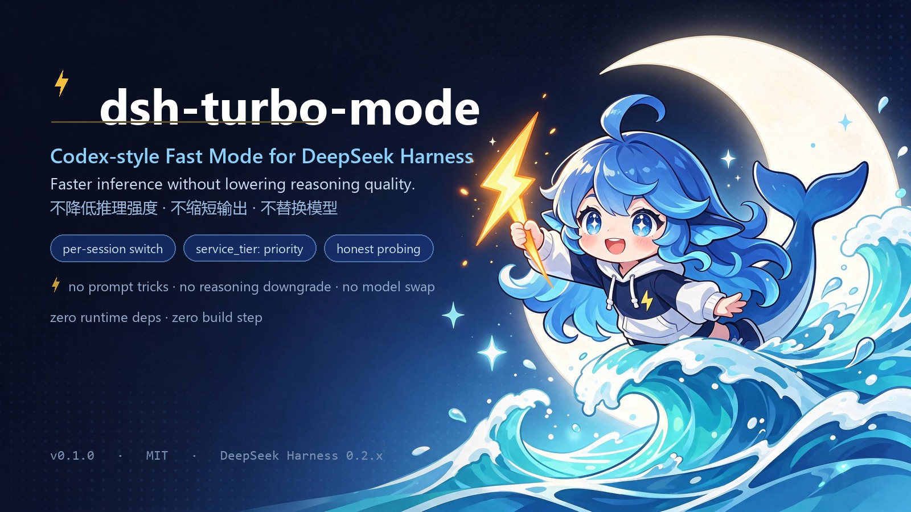
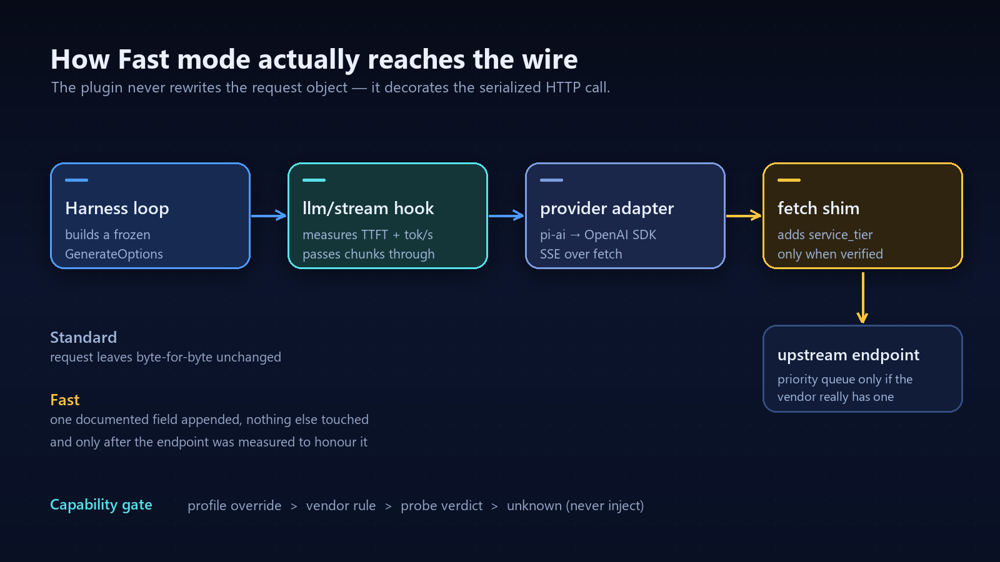
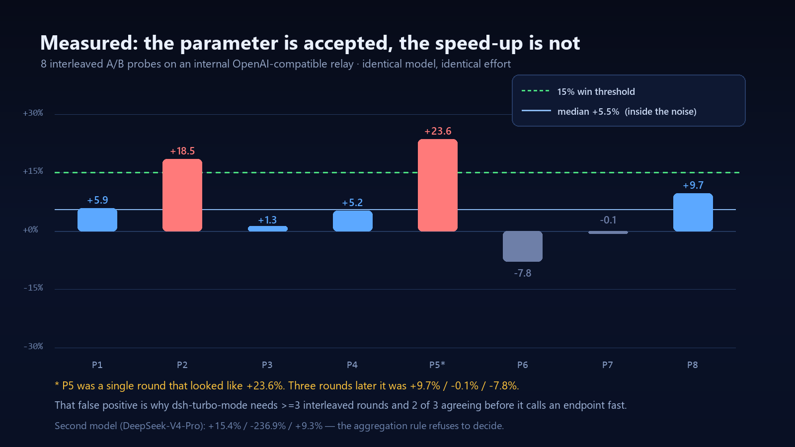

<div align="center">



**Codex-style Fast Mode for DeepSeek Harness — a turbo for the little whale.**
Same model, same reasoning effort — the request just gets to queue first.

[](./LICENSE)
[](https://github.com/deepseek-ai/deepseek-harness)
[](./package.json)
[](./test)

[中文](./README.md) · [Measured results](./docs/BENCHMARKS.md) · [Design notes](./docs/DETAIL.md)

</div>

---

## The problem it solves

Codex has a Fast Mode; DSH does not. This plugin adds it: **same model, same reasoning effort, same prompt — the request simply gets to use the provider's priority queue.**

The mechanism is generic: any endpoint that follows OpenAI's `service_tier` convention (for example `api.openai.com`) works out of the box, and switching providers does not mean switching plugins — the plugin decides what to send.

## Why it is worth installing

| | |
| --- | --- |
| 🚀 Real server-side speed | Appends one documented field to the request body; model, reasoning effort, prompt and tools stay untouched |
| 🔌 Zero deps, zero build | Plain ESM; `install_bundle` and it runs, no restart |
| 🧭 Capability detection | OpenAI → inject; other endpoints → probe first; unknown → never guessed |
| 📊 Real metrics | TTFT, tok/s, p95 and 429 counts, all taken from actual HTTP exchanges |
| 🛡️ 429 handling | Reads `Retry-After` and delays only: no retry loop, no key rotation, no bypass |
| 🫧 Honest fallback | No measured gain means no injection, and the UI says so instead of pretending |

## Measured

The author's own OpenAI-compatible relay, 8 interleaved A/B probes (same model, same effort, same prompt):

- the parameter is **accepted by the endpoint** (no 400 / 422) — it really reaches the wire;
- best single round **+23.6%**, with further rounds at **+18.5%** and **+9.7%** where the first token clearly came sooner;
- repeated runs did not reproduce it (median +5.5%).

In other words: **the priority lane belongs to the provider; the plugin decides, injects and verifies.** On that relay no stable gain appeared, so injection stays off there until your own endpoint proves otherwise. OpenAI's official endpoint documents `service_tier=priority`, and the plugin injects it out of the box.

Full method, raw numbers and reproduction commands: [docs/BENCHMARKS.md](./docs/BENCHMARKS.md).

---

## What it does

A small switch appears in the composer:


- **Standard** — the request goes out byte-for-byte unchanged.
- **Fast** — adds exactly one documented field, and only on an endpoint whose priority tier is confirmed. Model, reasoning effort, prompt, tools, temperature, max tokens and every verification step stay the same. If the endpoint is unsupported, unmeasured, or measured-without-effect, Fast stays off and the reason is printed next to it.

### What it never does

- ❌ no system-prompt tricks, no "write less" guidance (that would trade quality for speed)
- ❌ no `reasoningEffort` changes, no shortened thinking
- ❌ no switching to a cheaper model
- ❌ no skipped validation steps
- ❌ no fabricated numbers, no pretending a speed-up happened
- ❌ no key rotation, no rate-limit evasion, no infinite retries

---

## How it reaches the wire

<div align="center">

</div>

The `GenerateOptions` the Harness loop hands to an adapter is **deep-frozen**, so no plugin can rewrite it — a speed-up cannot come from mutating the request object. dsh-turbo-mode does exactly two things:

1. it **listens** on `llm/stream` (measures time-to-first-token and throughput, never alters a chunk);
2. it adds one field to the **serialized HTTP body** — and only when that endpoint is known to have a priority tier.

Proxies replace `globalThis.fetch` all the time, so the hook ships with a 2-second watchdog and re-arms itself when it gets covered up.

---

## Measured

<div align="center">

</div>

Eight interleaved A/B probes, same model, same reasoning effort, same one-line prompt:

| Metric | Value |
| --- | --- |
| Median gain | **+5.5%** (noise) |
| Best single probe | +23.6% — a **one-round false positive** that became −0.1% / −7.8% / +9.7% over three rounds |
| Did the parameter reach the wire? | Yes (`paramSent: true`, no 400/422) |
| Verdict | parameter accepted, **no reproducible server-side speed-up** |

That is precisely why the plugin probes before it switches. Full method, raw numbers and reproduction commands: [docs/BENCHMARKS.md](./docs/BENCHMARKS.md).

---

## Install

DSH plugins install as a **bundle**; requires DSH ≥ 0.2.2.

**Option 1 — straight from GitHub (recommended, no npm account needed)**

Type this into the Plugins panel install box:

```
github:iambubu0523/dsh-turbo
```

On the host side this is `plugin_manager`'s `install_bundle` with that spec as the target; the manager has pnpm
clone the package from GitHub. Measured on the author's machine: `+ dsh-turbo-mode 0.1.0`, 5.6 s, zero dependencies.

Pin a release if you prefer:

```
github:iambubu0523/dsh-turbo#v0.1.0
```

**Option 2 — a local directory**

`git clone` the repo (or unpack a Release archive) anywhere, then install that folder by its **absolute path**
(e.g. `C:\Users\you\plugins\dsh-turbo`).

**Option 3 — npm (not published yet)**

The package name is `dsh-turbo-mode`; once published, that name alone works in the panel.

> Note: this project is **`dsh-turbo-mode`**. The `dsh-turbo` package on npm belongs to someone else — do not mix them up.

No restart needed: the Turbo switch appears under the composer. If it does not, toggle the bundle off and on
in the Plugins panel to hot-reload.

Verified on the author's machine for both the GitHub spec and the local-directory route: `application: "applied"`, `warnings: []`.

### Uninstall

Disable or remove the bundle in the Plugins panel. The HTTP routes, the fetch hook, the `turbo_mode` tool and the composer switch are unregistered together. The only leftovers are two JSON files under `<DSH_HOME>/dsh-turbo/`, which you can delete by hand.

---

## Usage

- **Click the switch** — applies to the session on screen; with no session selected it changes the profile default that new sessions inherit.
- **Ask the agent** — "turn Fast on" makes it call the `turbo_mode` tool (`action: status | set | metrics | probe`).
- **Probe a relay** — `turbo_mode` with `action: "probe"`. Same model, same reasoning effort, one tiny prompt, standard and fast **interleaved** N times each, comparing time-to-first-token.
  - One round never decides: `samples < 3` always answers `inconclusive` (identical requests on a shared path swing by 20%; this project measured one +23.6% false positive).
  - Verdicts are aggregated over history: the last five probes per endpoint+model are kept, the last three decisive ones are considered, and at least **two** of them must show a ≥15% median win (with a majority of rounds faster) before an endpoint counts as verified. All flat → no effect. Split → unknown, and Fast stays off until the win repeats.
- **Read the numbers** — `GET /turbo/state`, `GET /turbo/metrics` (loopback only).

### Supported endpoints

| Endpoint | Behaviour |
| --- | --- |
| `api.openai.com` (and subdomains) | sends `service_tier: "priority"` (documented by OpenAI) |
| `api.deepseek.com` | sends nothing (no such tier) |
| anything else, including OpenAI-compatible relays | nothing until probed; nothing again once a probe shows no effect |
| an endpoint you declare in config | follows your declaration |

An unknown endpoint is never guessed into. `unknown` is not treated as "probably fine".

---

## Configuration

The package ships sane defaults in its own `cordis.patch.yml`. To override, add a same-id block to the **profile**'s `cordis.patch.yml`:

```yaml
- id: turbo
  name: dsh-turbo-mode
  config:
    defaultSpeed: standard      # standard | fast, seeds new sessions
    holdMs: 15000               # longest 429 hold
    metricsCapacity: 200        # samples kept in memory
    probeSamples: 3             # probe rounds (max 5)
    dshHome: null               # override the state directory
    providers: {}               # per-endpoint capability declarations
```

When a relay documents something the built-in table does not know:

```yaml
    providers:
      'relay.example.com':
        support: documented
        param: { service_tier: priority }
        note: 'relay docs: priority processing on request'
```

Use `support: unsupported` to forbid injection on an endpoint that rejects it.

---

## How it works

The Harness loop deep-freezes request options before sending, and the LLM call config has no slot for provider-private parameters. So the parameter has to be added at the **serialized HTTP layer**:

```
Harness loop → llm/stream (measurement only, request untouched)
             → adapter → fetch hook
                          ├─ session on Standard → pass through untouched
                          ├─ session on Fast and endpoint confirmed → add one field to the body
                          └─ otherwise → pass through, record why
```

- Session ownership travels through `AsyncLocalStorage`, so concurrent sessions never leak into each other's tier.
- The fetch hook re-checks every 2 s and re-wraps if another integration (a local relay proxy, for instance) replaced `globalThis.fetch` — otherwise Fast would silently downgrade to Standard. That was a real bug found in this project, and it is covered by a unit test.
- `transport.armed` only says our hook is the outermost fetch. A proxy wrapped *above* us that still delegates down keeps Fast working, so the real evidence is `transport.delivering` (the hook was reached within the last 15 s) plus the `transport.injected` counter.

### What the numbers mean

All of them come from real HTTP exchanges; none are estimated:

- **TTFT** — wall time from sending the request to the first `text-delta` / `reasoning-delta`.
- **tok/s** — `usage.outputTokens ÷ generation time`.
- **total** — until the stream ends.
- **throttled / retried / held** — 429 count, retry marks, and how often a request deliberately waited to honour `Retry-After`.

---

## Stability

- **429** — reads `Retry-After` (seconds or HTTP date) and holds the next request for that window, capped by `holdMs` (default 15 s). **Delay only: no retry loop, no credential rotation, no concurrent hammering.**
- It registers no desktop-control capability and does not touch DSH's desktop-operation safety rules.
- Timers/injection run inside `try/finally` and always release the upstream stream (`iterator.return()`), so an aborted turn cannot leave a socket dangling.

---

## Development

Zero dependencies, zero build, plain ESM:

```bash
node --test "test/**/*.test.js"     # 46 cases
```

Covers capability precedence, state persistence and corrupt-state recovery, metric aggregation, the fetch hook (inject / do-not-inject / 429 hold / self-healing) and probe verdicts (including detection of "the parameter never reached the wire").

## Limitations

- A client cannot speed up server-side token generation; the provider must offer a priority queue.
- First-token latency is noisy on a shared network, so the probe's 15% threshold is deliberately conservative — which is why every measurement is stored in `capability.json` instead of being claimed in prose.
- If a relay "accepts but ignores" the tier parameter, this plugin reports it as **no effect**, not as a win.

## Credits

<p></p>

The repo/org avatar is the square close-up at `docs/assets/avatar.png`.

The whale-girl look is a community creation. This project's avatar and banner were generated from the public character description shared by the [deepseek-whale-girl](https://github.com/TreapGoGo/deepseek-whale-girl) community (their prompt text is licensed CC BY-SA 4.0). No image asset from that repository is copied here.

- [dsh-relay-fast](https://github.com/Rock-ql/dsh-relay-fast) — the original `service_tier` injection approach
- [DeepSeek Harness](https://github.com/deepseek-ai/deepseek-harness) — the Cordis plugin framework

## License

MIT — see [LICENSE](./LICENSE).
