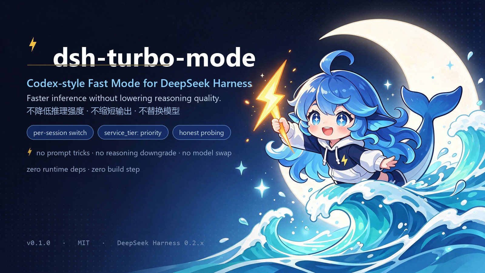
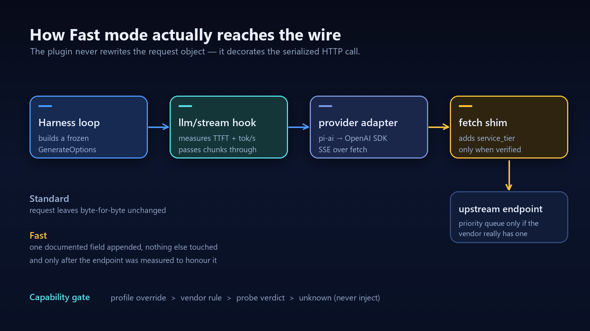
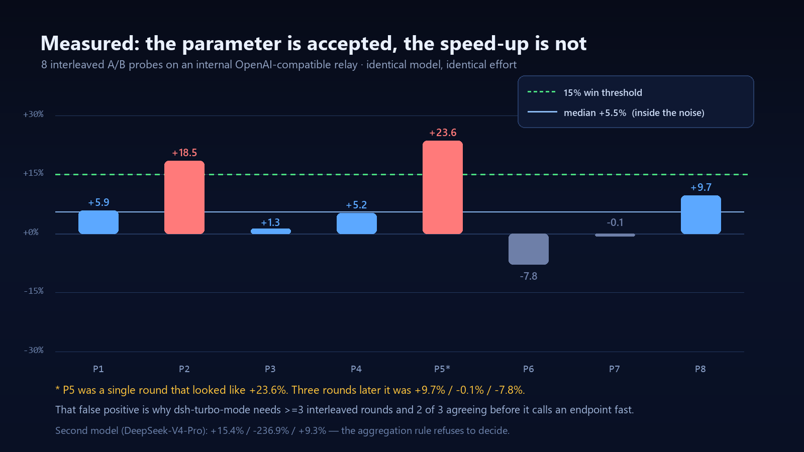

<div align="center">



**Codex 风格的 Fast Mode，给小鲸鱼装上涡轮。**
同样的模型、同样的推理强度，只是请求优先排队。

[](./LICENSE)
[](https://github.com/deepseek-ai/deepseek-harness)
[](./package.json)
[](./test)

[English](./README.en.md) · [实测报告](./docs/BENCHMARKS.md) · [设计细节](./docs/DETAIL.md)

</div>

---

## 它解决什么问题

Codex 有 Fast Mode，DSH 没有。这个插件把它补上：**同一个模型、同一个推理强度、同一句提示词，只是让请求走服务商的优先队列。**

机制是通用的——只要端点遵循 OpenAI 的 `service_tier` 约定（例如 `api.openai.com`），装上即生效；换服务商不用换插件，插件自己判断该不该发。

## 为什么值得装

| | |
| --- | --- |
| 🚀 真·服务端加速 | 在请求 JSON 里加一个官方字段，模型 / 推理强度 / 提示词 / 工具全部不动 |
| 🔌 零依赖零构建 | 纯 ESM，`install_bundle` 装完即用，不用重启 |
| 🧭 能力自判 | OpenAI 官方 → 直接注入；其它端点 → 先 probe 再决定；未知 → 绝不乱发 |
| 📊 真实指标 | 首字延迟、tok/s、P95、429 次数，全部来自真实 HTTP 交换，不是估算 |
| 🛡️ 429 兜底 | 读 `Retry-After` 只延迟不重试，不轮换密钥、不绕限流 |
| 🫧 诚实降级 | 测不到收益就不注入，界面上明写「未生效」，不假装加速 |

## 实测

作者自己的 OpenAI 兼容中转，8 次交错 A/B（同模型、同推理强度、同 prompt）：

- **参数被端点接受**（无 400 / 422），确认真的到达线上
- 单轮最佳 **+23.6%**，另有 **+18.5%**、**+9.7%** 的轮次首字明显更快
- 但重复测试没有稳定复现（中位 +5.5%）

也就是说：**快车道归服务商管，插件负责判断、注入、验证。** 在这台中转上没测出稳定收益，所以插件默认不注入，等你自己的端点跑一次 probe 测出来再开。OpenAI 官方端点文档明确支持 `service_tier=priority`，插件开箱即注入。

完整方法、原始数字与复现命令见 [docs/BENCHMARKS.md](./docs/BENCHMARKS.md)。

---

## 它做什么

输入框右下角会出现一个开关：


- **标准**：请求原样发出，一个字节都不改。
- **极速**：仅在该端点**被确认支持**优先档位时，在请求 JSON 里增加一个字段。
  - 模型、推理强度、提示词、工具、温度、max tokens、验证步骤——全部不变。
  - 若端点不支持 / 未测量 / 测过但没效果，开关不生效，并在旁边写明原因（例：`该接入点没有官方优先档位，Fast 未生效`）。

### 它绝不做什么

- ❌ 不改系统提示词，不要求模型"少说点"（那是 prompt 侧提速，会降低质量）
- ❌ 不改 `reasoningEffort`，不缩短思考
- ❌ 不换更便宜的模型
- ❌ 不减少校验步骤
- ❌ 不伪造数据，不假装加速
- ❌ 不轮换密钥、不绕限流、不无限重试

---

## 它是怎么做到的

<div align="center">

</div>

DSH 的 loop 交给适配器的 `GenerateOptions` 是**深冻结**的，插件不可能改它——所以加速不能靠改请求对象。
dsh-turbo-mode 只做两件事：

1. 在 `llm/stream` 里**旁听**（只测量首字延迟与吞吐，不改一个 chunk）；
2. 在**序列化后的 HTTP 层**给那个 JSON 加一个字段——而且只在"这个端点确实有优先档位"时才加。

代理服务器替换 `globalThis.fetch` 是常态，所以钩子带 2 秒看门狗：被覆盖了就自动重挂。

---

## 实测结果

<div align="center">

</div>

8 次交错 A/B，同一模型、同一推理强度、同一句 prompt：

| 指标 | 数值 |
| --- | --- |
| 中位提升 | **+5.5%**（噪声级别） |
| 最大值 | +23.6%（**单轮假阳性**，三轮后变成 −0.1% / −7.8% / +9.7%） |
| 参数是否到达线上 | 是（`paramSent: true`，无 400/422） |
| 结论 | 参数被接受，**没有可复现的服务端加速** |

这就是为什么插件要"先测再开关"。完整方法、原始数字与复现命令见 [docs/BENCHMARKS.md](./docs/BENCHMARKS.md)。

---

## 安装

DSH 插件以 **bundle** 形式安装，需要 DSH ≥ 0.2.2。

**方式一：直接从 GitHub 装（推荐，不需要 npm 账号）**

在插件面板的安装框里填：

```
github:iambubu0523/dsh-turbo
```

host 侧对应 `plugin_manager` 的 `install_bundle`（target = 上面这串 spec），插件管理器会用 pnpm 从 GitHub 直接拉包。
本机实测：`+ dsh-turbo-mode 0.1.0`，5.6 秒装完，零依赖。

想锁定版本就把 tag 带上：

```
github:iambubu0523/dsh-turbo#v0.1.0
```

**方式二：本地目录**

`git clone` 或下载 Release 压缩包解压到任意位置（例如 `~/plugins/dsh-turbo`），
然后在插件面板里填该目录的**绝对路径**（如 `C:\Users\you\plugins\dsh-turbo`）。

**方式三：npm（待发布）**

包名 `dsh-turbo-mode`，发布后在面板里填这个名字即可。当前 npm 上还没有。

> 注意：本项目的包名是 **`dsh-turbo-mode`**。npm 上已有的 `dsh-turbo` 是另一个作者的项目，不要混装。

装好后**无需重启**，输入框下方即出现 Turbo 开关（若未出现，在插件页把该 bundle 关掉再打开一次即可热重载）。

本机已验证的安装返回值：`application: "applied"`，`warnings: []`（GitHub spec 与本地目录两种方式都实测过）。

### 卸载

在插件面板停用或卸载该 bundle 即可：HTTP 路由、fetch 钩子、`turbo_mode` 工具、输入框开关会一起注销。唯一残留是 `<DSH_HOME>/dsh-turbo/` 下的两个 JSON（`state.json`、`capability.json`），可手删。

---

## 使用

- **点开关**：对**当前会话**生效；没选过会话时改的是默认档位（新会话继承）。
- **让 agent 改**：对 agent 说"把极速打开"，它会调用 `turbo_mode` 工具（`action: status | set | metrics | probe`）。
- **测一个中转**：`turbo_mode` 传 `action: "probe"`。插件会用同一个模型、同一个推理强度、同一句极小 prompt，**交错**各发 standard / fast 各 N 次，比较**首字延迟**。
  - 单轮不下结论：`samples < 3` 一律返回 `inconclusive`（同一请求在共享网络上能摆动 20%，本项目实测到过一次 +23.6% 的假阳性）。
  - 判定按**历史聚合**：每个端点+模型保留最近 5 次探测，取最近 3 次有效结果，**至少 2 次**快 ≥15%（且多数轮次更快）才判为"已验证"；全都不快判"无效"；一次快一次不快判"未知"，Fast 保持关闭等它复现。
- **看数据**：`GET /turbo/state`、`GET /turbo/metrics`（仅回环地址可访问）。

### 支持的端点

| 端点 | 行为 |
| --- | --- |
| `api.openai.com`（含子域） | 注入 `service_tier: "priority"`（OpenAI 文档化能力） |
| `api.deepseek.com` | 明确不发（厂商无此档位） |
| 其它（含 OpenAI 兼容中转） | **默认不发**。先 probe，测出有效果才发；测出没效果则永不再发 |
| 你在配置里显式声明的端点 | 按你的声明执行（见下） |

未知端点绝不会被"猜着"注入参数——`unknown ≠ 大概率没问题`。

---

## 配置

插件自带 `cordis.patch.yml` 默认值；要覆盖时在 **profile** 的 `cordis.patch.yml` 里加同 id 的配置块：

```yaml
- id: turbo
  name: dsh-turbo-mode
  config:
    defaultSpeed: standard      # standard | fast，作为新会话默认
    holdMs: 15000               # 429 最长等待
    metricsCapacity: 200        # 内存里保留的样本数
    probeSamples: 3             # 每次 probe 的轮数（上限 5）
    dshHome: null               # 覆盖状态目录
    providers: {}               # 按端点的能力声明
```

中转方有书面说明、但不在内置表里时：

```yaml
    providers:
      'relay.example.com':
        support: documented
        param: { service_tier: priority }
        note: '中转文档说明支持优先处理'
```

反过来，若某端点会拒绝该参数，用 `support: unsupported` 直接禁掉注入。

---

## 它是怎么工作的

DSH 的 loop 在发出模型请求前会把 options **深度冻结**，且 LLM 调用配置没有"服务商私有参数"的入口。所以参数只能在**序列化后的 HTTP 层**加：

```
Harness loop → llm/stream（只测量，不改请求）
             → 适配器 → fetch hook
                          ├─ 该会话是标准档？→ 原样透传
                          ├─ 该会话是极速档 且 端点已确认支持？→ body 里加一个字段
                          └─ 否则 → 原样透传，并记录原因
```

- 会话归属用 `AsyncLocalStorage` 传递，**并发会话不会串档**。
- fetch 钩子每 2s 自检一次：如果别的集成（例如本机中转代理）把 `globalThis.fetch` 换掉了，钩子会重新包一层，避免"静默降级成标准档"——这是本项目踩过的真实坑。
- 状态里 `transport.armed` 只表示"我们的钩子是最外层 fetch"；代理若包在我们**上面**但仍然向下委派，请求照样经过钩子。所以真正的证据是 `transport.delivering`（最近 15s 内钩子确实被调用过）和 `transport.injected` 计数。
- 其它集成替换 fetch 的场景已被单元测试覆盖。

### 指标含义

全部来自真实 HTTP 交换，没有估算：

- **TTFT / 首字**：从发请求到收到第一个 `text-delta`/`reasoning-delta` 的墙钟时间。
- **tok/s**：`usage.outputTokens ÷ 生成耗时`。
- **总耗时**：到流结束。
- **限流**：`status 429` 计数；**重试**：`retried` 标记；**held**：为遵守 `Retry-After` 而主动等待的次数。

---

## 稳定性

- **429**：读取 `Retry-After`（秒数或 HTTP 日期），下一次请求前等待该窗口（上限 `holdMs`，默认 15s）。**只延迟，不重试、不换密钥、不并发轰炸。**
- **不排队抢夺桌面控制**：本插件不注册任何桌面控制能力，也不会改变 DSH 原有的桌面操作安全机制。
- 所有计时/注入逻辑都在 `try/finally` 内释放上游流（`iterator.return()`），避免中断后 socket 悬挂。

---

## 开发与测试

零依赖、零构建，纯 ESM：

```bash
node --test "test/**/*.test.js"     # 46 个用例
```

覆盖：能力判定优先级、状态持久化与损坏恢复、指标聚合、fetch 钩子的注入/不注入/429 等待/自愈、probe 判定逻辑（含"参数根本没上线"的检测）。

## 局限（请照实理解）

- 客户端**无法**提升服务端生成速度；能加速的前提是服务商提供优先队列。
- 首字延迟受网络与代理影响很大，probe 的 15% 阈值是保守值，仍可能被噪声影响——这也是本插件把每次实测数字都写进 `capability.json` 的原因。
- 中转方若"接受但不实现" `service_tier`，本插件会如实判定为**无效**。

## 致谢

<p></p>

仓库/组织图标用的是同一角色的方形特写：`docs/assets/avatar.png`。

角色形象「鲸鱼娘」由社区共创，本项目的头像与头图按 [deepseek-whale-girl](https://github.com/TreapGoGo/deepseek-whale-girl) 社区的公开设定描述生成；该社群的提示词文本按 CC BY-SA 4.0 共享，此处仅作参考致谢，不复制其图片素材。

- [dsh-relay-fast](https://github.com/Rock-ql/dsh-relay-fast) —— 早期 `service_tier` 注入思路
- [DeepSeek Harness](https://github.com/deepseek-ai/deepseek-harness) —— Cordis 插件框架

## 许可

MIT。见 [LICENSE](./LICENSE)。
